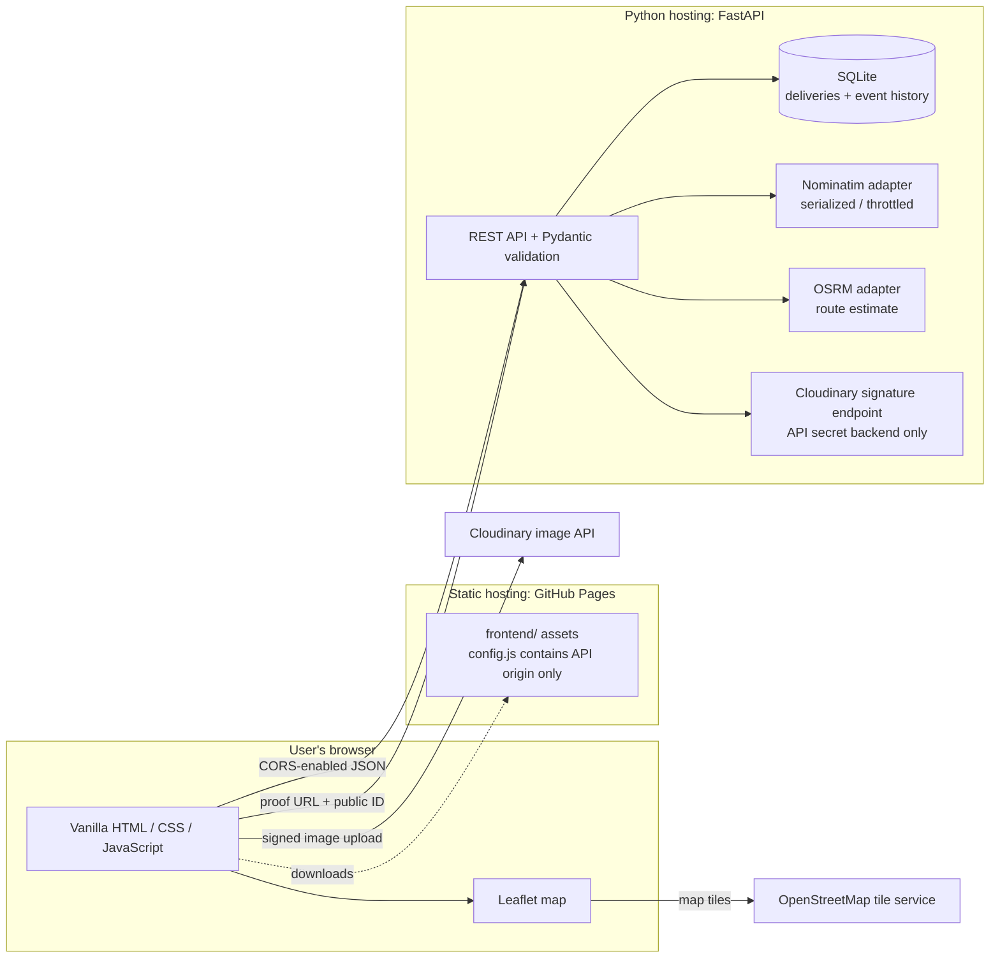

# Architecture

## Data flow

1. The static frontend obtains deliveries, summary metrics, history, and reports from the FastAPI API. Delivery writes are validated and persisted in SQLite; create/status changes append history events.
2. Address lookup is proxied through the backend to Nominatim so the request carries the configured identifying User-Agent and is throttled. Route requests are sent to OSRM with a fixed depot plus selected stops; returned distances/duration/geometry are labelled as estimates.
3. Proof upload is browser-to-Cloudinary. The backend signs the preset/folder/timestamp using its private API secret, then the browser uploads with the signature. The frontend records the provider URL/public ID through the API, which stores the proof event. The raw image is not stored in SQLite.
4. OpenStreetMap supplies displayed map tiles. These external services are independently available or unavailable; none is simulated as a successful live result.

## Trust and deployment boundaries

The browser is not trusted to protect API data. CORS only constrains browser-origin requests and does not prevent direct API clients. Authentication and authorization are not implemented, so a public backend is suitable only for non-sensitive demonstrations until access controls are added. Secrets belong in server environment configuration. GitHub Pages serves only static frontend assets. Render's configured persistent disk holds the SQLite file; the single-process database design is not intended for multi-instance scaling.
